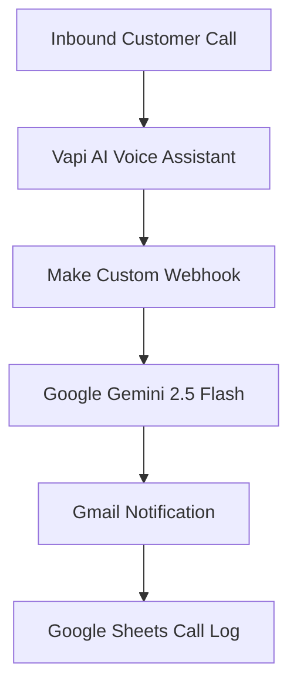

# Automated Real Estate Lead Handling with Make + Vapi

## Project Overview

An AI-powered real estate automation solution designed
to streamline inbound calls, lead management, property
viewing requests, and customer follow-ups.

Developed for a demonstration company, Great Home Realtors,
this project integrates conversational AI, generative AI,
and workflow automation to reduce manual administrative
work and improve the customer experience.

## Business Problem

Real estate agents spend significant time answering calls,
collecting customer information, documenting conversations,
and managing follow-ups.

These manual processes can lead to:

- Missed business opportunities
- Delayed customer responses
- Inconsistent lead documentation
- Increased administrative workload
- Missed follow-up opportunities

## The Solution

This project uses a Vapi AI voice assistant to interact
with customers and transfer call information to Make.

Google Gemini processes the information, generates a
structured call summary, and recommends the next best
action. The workflow automatically distributes the
summary through Gmail and records it in Google Sheets.

## Technology Stack

| Technology | Purpose |
|---|---|
| Vapi | Conversational AI voice assistant |
| Make.com | Workflow automation and orchestration |
| Google Gemini 2.5 Flash | AI-powered call analysis and summarization |
| Gmail | Automated email notifications |
| Google Sheets | Centralized lead and call tracking |
| Webhooks | Real-time data transfer |
| JSON | Workflow configuration and data exchange |

## Workflow Architecture

## How It Works

### 1. AI Voice Assistant - Vapi

The AI voice assistant interacts with prospective customers,
handles real estate inquiries, and collects relevant
customer and appointment information.

### 2. Custom Webhook - Make

The webhook receives call information from Vapi and
automatically triggers the Make scenario.

### 3. AI Call Analysis - Google Gemini

Gemini 2.5 Flash processes the incoming call information
and generates a structured summary containing:

- Customer name
- Appointment date and time
- Phone number and email address
- Buying or selling interests
- Recommended next best action
- Appointment cancellation details, when applicable

The AI prompt is designed to prevent fabricated information
and keep each summary under 120 words.

### 4. Automated Email Notification - Gmail

The workflow sends the AI-generated call summary to the
real estate team with the subject:

**New Realtor Call Summary**

This allows agents to review customer inquiries without
having to manually document each conversation.

### 5. Lead Management - Google Sheets

The workflow automatically creates a new record in the
centralized call log.

The following information is recorded:

| Field | Description |
|---|---|
| Status | Defaults to New |
| Call Received | Date and time of the customer interaction |
| Summary | AI-generated call summary |
| Follow-Up Date | Three days after the original call |

Dates and timestamps are formatted using the
America/Chicago time zone.

## Key Features

- AI-powered customer interactions
- Automated lead capture
- Real-time webhook integration
- Generative AI call summarization
- Property viewing request handling
- Appointment cancellation handling
- Automated email notifications
- Centralized customer inquiry tracking
- Automatic follow-up date calculation
- AI-generated next-best-action recommendations

## Example Use Case

A prospective homebuyer contacts Great Home Realtors
to inquire about a property and request a viewing.

The AI voice assistant collects the customer's information
and sends the call details to Make.

Gemini generates a concise summary, identifies the
customer's needs, and recommends a follow-up action.

The real estate team receives an automated email, while
Google Sheets stores the call information and calculates
a follow-up date.

This eliminates the need for agents to manually document
the interaction.

## Business Benefits

- Reduces repetitive administrative tasks
- Minimizes missed lead opportunities
- Supports 24/7 customer availability
- Improves lead response times
- Standardizes customer documentation
- Improves visibility into customer inquiries
- Supports consistent follow-up processes
- Allows agents to focus on revenue-generating activities

## Installation and Configuration

1. Download the JSON blueprint from this repository.
2. Log in to Make.com.
3. Create a new scenario.
4. Select Import Blueprint.
5. Upload the JSON blueprint.
6. Create and configure a custom webhook.
7. Connect the Vapi assistant to the webhook.
8. Configure the Google Gemini connection.
9. Connect your Gmail account and update the recipient.
10. Connect Google Sheets and configure the call log columns.
11. Run a test call to validate the workflow.
12. Activate the scenario.

## Prerequisites

- Make.com account
- Vapi account and configured voice assistant
- Google Gemini API access
- Gmail account
- Google Sheets account

The Make blueprint requires users to configure their own
connections, webhook, email recipient, and spreadsheet.

The Vapi assistant configuration is managed separately
and is not included in the Make blueprint.

## Future Enhancements

- CRM integration with HubSpot or Salesforce
- Google Calendar integration for appointment scheduling
- Automated SMS follow-ups using Twilio
- AI-powered lead scoring and qualification
- Customer sentiment analysis
- Duplicate lead detection
- Automated follow-up reminders
- Lead conversion and performance dashboards
- Advanced error handling and retry mechanisms

## Skills Demonstrated

- AI Automation
- Conversational AI
- Prompt Engineering
- Business Process Automation
- Workflow Design and Orchestration
- API Integration
- Webhook Integration
- JSON Data Mapping
- Generative AI
- Low-Code/No-Code Development
- Business Process Analysis
- Systems Integration

## Project Status

Portfolio demonstration and proof of concept.

Designed to demonstrate how conversational AI and
intelligent workflow automation can support real estate
operations and customer relationship management.

## Author

**Mark Davis**

AI Automation | Business Systems | ERP & Systems Integration
